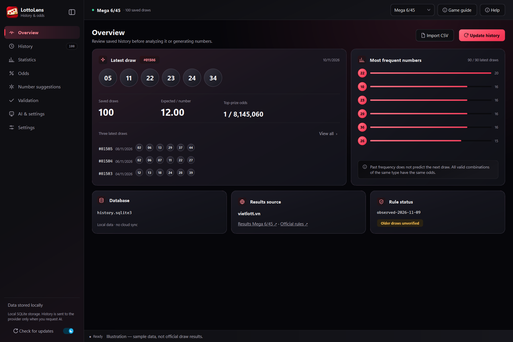
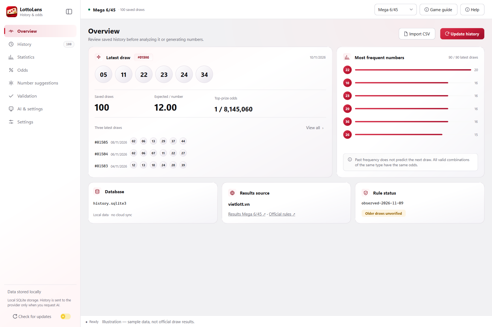
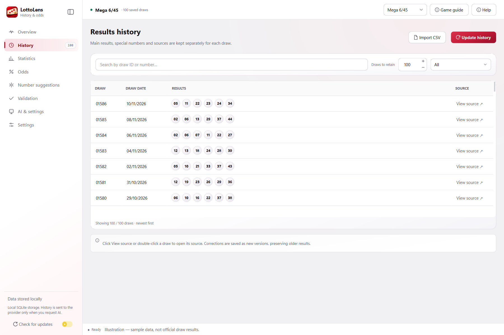
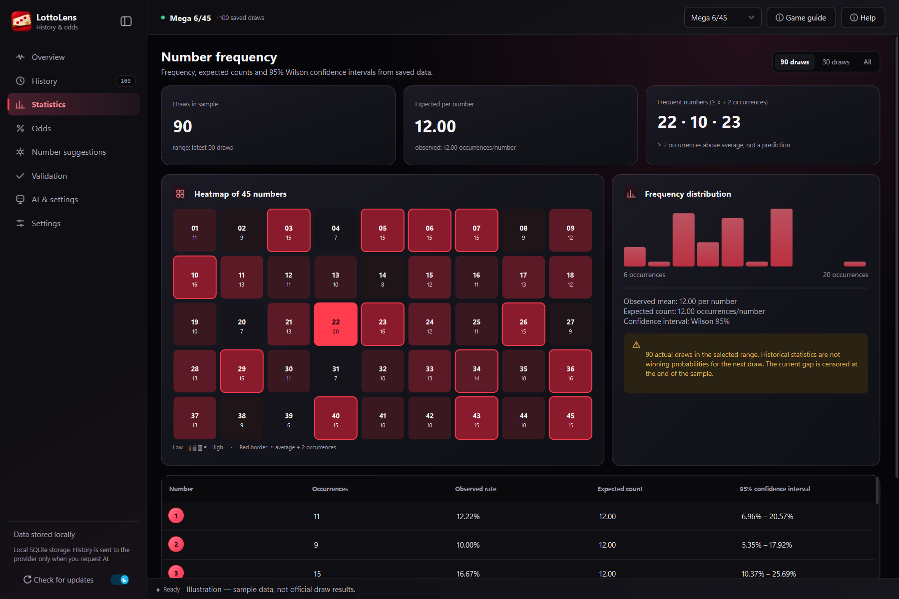
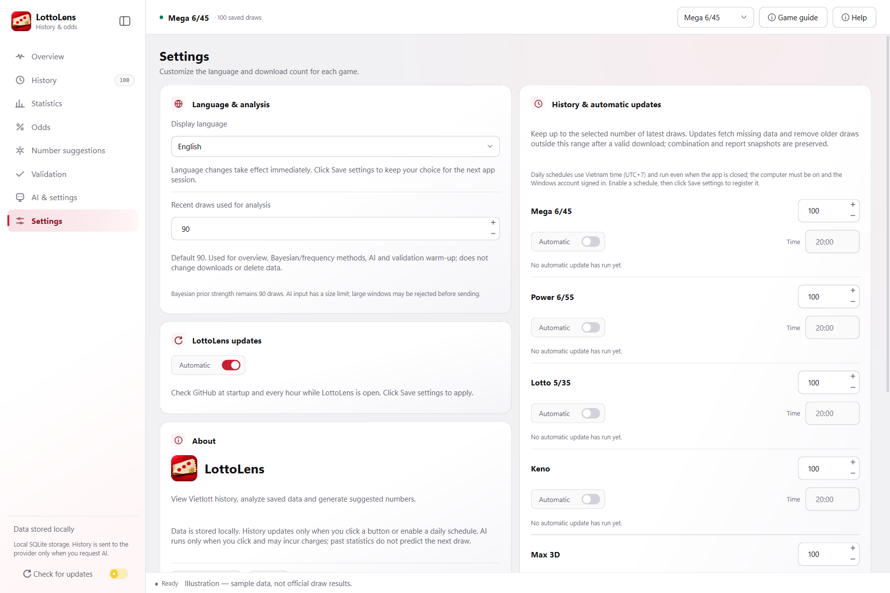
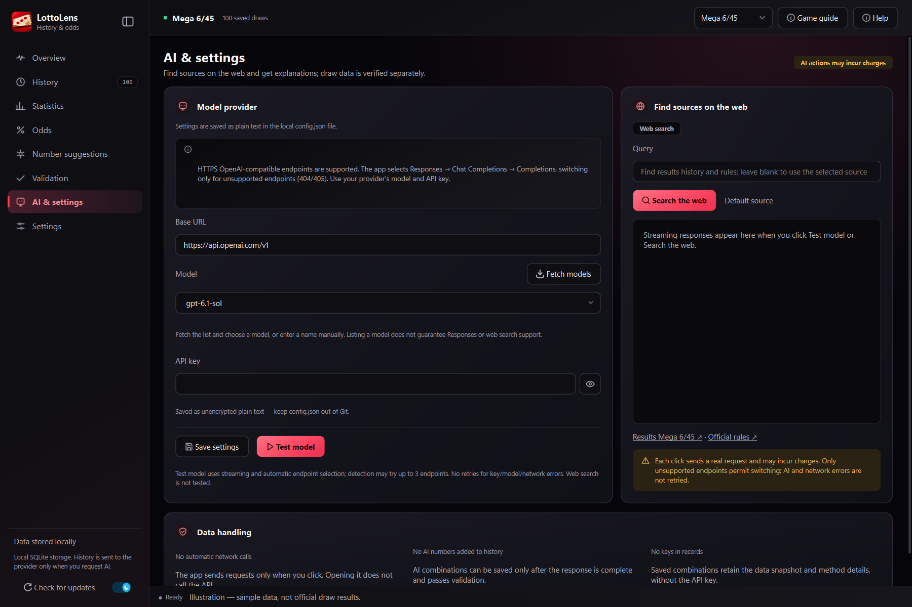

<p align="center"></p>
<h1 align="center">LottoLens</h1>
<p align="center">Vietlott history, probability and statistics — in a desktop app.</p>
<p align="center"><a href="README.md">Tiếng Việt</a> · <strong>English</strong></p>
<p align="center">
  
  
  
  <a href="LICENSE"></a>
</p>
<p align="center"><strong><a href="https://github.com/TKNguyenn/LottoLens/releases/download/v0.8.0/LottoLens-Setup-0.8.0.exe">Download Windows setup V0.8.0</a></strong> · <a href="https://github.com/TKNguyenn/LottoLens/releases/tag/v0.8.0">Release notes</a></p>



**LottoLens** is a Python/PySide6 desktop app for browsing Vietlott history, exploring saved data, calculating theoretical probabilities and evaluating number-selection methods. Data is stored locally in SQLite. AI is optional.

> LottoLens does not promote betting, gambling or superstition. Past statistics, suggested numbers and AI output do not guarantee future predictions or improved winning chances. Read the [bilingual usage policy](POLICY.md).

*Screenshots show the actual app with synthetic data, not official draw results. Open an image to view it at full size.*

## Features

- **History with sources:** fetch Vietlott results, search by draw or number and open the original source. Updates are incremental when a verified history boundary exists.
- **Statistics and probabilities:** frequencies, heatmaps and theoretical odds, with a configurable recent-draw analysis window.
- **Number suggestions:** uniform, frequency, Bayesian and AI methods. Save suggestions with their method and history snapshot.
- **Simulation and validation:** simulate tickets and compare methods with random selection across all seven games. Reports show winning tickets, rates and prize tiers.
- **Per-game daily updates:** Vietnam-time schedules using Windows Task Scheduler, even while the app is closed.
- **Vietnamese and English:** immediate language switching, light/dark gradients, a collapsible sidebar, illustrated onboarding and game guides.
- **Optional AI:** HTTPS OpenAI-compatible endpoints, model fetching, manual model entry and streaming.
- **App updates:** check GitHub from the sidebar, with an automatic-check setting and confirmation before the installer downloads.

<details>
<summary>See light mode</summary>



</details>

## Getting started

### Windows installer

Download [LottoLens-Setup-0.8.0.exe](https://github.com/TKNguyenn/LottoLens/releases/download/v0.8.0/LottoLens-Setup-0.8.0.exe) for **Windows 10/11 x64**. To upgrade an existing copy, close LottoLens and select its current installation folder to keep using the existing `data` folder.

The installer lets you choose where to store the app and its data. The final page offers desktop-shortcut and launch checkboxes. Uninstall can **keep user data** or **remove all user data**. Both options remove this installation's scheduled tasks. The installer is unsigned, so Windows may show an unknown-publisher warning.

From V0.8.0, use **Check for updates** at the bottom of the sidebar. By default, the app checks at startup and every hour while open. To turn off automatic checks, go to **Settings → LottoLens updates** and click **Save settings**. The app asks before downloading a new version and verifies the installer's SHA-256.

### Run from source

Tested with **Windows x64, Python 3.11 and PySide6 6.11.2**.

```powershell
git clone https://github.com/TKNguyenn/LottoLens.git
cd LottoLens
py -3.11 -m venv .venv
.\.venv\Scripts\python.exe -m pip install -r requirements.txt
.\.venv\Scripts\python.exe main.py
```

On first launch, the main window appears behind the policy dialog. Check **I have read** and **I accept** separately to continue to the illustrated tutorial. Reopen it through **Help** in the top bar; the policy is available under **Settings → About**.

## How to use it

### 1. Choose a game and fetch history

Select a game in the top bar, then click **Update history**. The initial update downloads the configured range, 100 draws by default. Later updates fetch new results until the verified boundary; increasing the limit or revalidating data may require fetching the full range again.

After a valid update, the app retains up to the selected count and removes older draws outside that range. Saved suggestions, reports and snapshots are preserved. Failed, cancelled or incomplete downloads leave history unchanged. **Import CSV** supports set-based games using the [format below](#csv-and-command-line).



### 2. Explore statistics and theoretical odds

Use **Statistics** for frequencies and heatmaps. Use **Odds** for theoretical probabilities by game, ticket or play type. **Game guide** explains selection rules, draw mechanics and winning conditions, with official source links.

**Observed frequency is not a forecast probability.** Under a fair-draw assumption, all valid combinations of the same ticket type have the same theoretical odds.



### 3. Generate suggestions and validate methods

In **Number suggestions**, choose a method and count, then generate. Uniform selection works without saved history; frequency, Bayesian and AI methods need the configured analysis window. Enter an **Intended draw** only when saving for later comparison.

In **Validation**, select a method to compare with random selection. If the analysis window is 100 and only 100 draws are saved, validation uses at most 99 as input, reserves a draw for evaluation and displays a note. At least two draws are required. **Run AI validation** sends the history before the latest draw to your configured model and may incur charges. The app scores the tickets on one saved draw and compares them with 200 local random-selection runs. The model may already know the public result, so treat the comparison as exploratory.

Click **Run simulation** to test one ticket across 10,000 synthetic draws. For Max 3D, Max 3D Pro and Bingo18, choose the ticket on the Validation page. Bingo18 backtesting uses the same play type and up to five distinct tickets per draw. **High–Tie–Low** has three choices and **Any triple** has one.

To generate rows that look like Bingo18 draw results, go to **Number suggestions → Simulated results (3 numbers)**, set the count and click **Generate simulated results**. Each row contains three numbers from 01 to 06 and may include repeats. The rows appear in the table for review. Use the **Odds** page to see the probabilities for a specific play and selection.

Triple generation supports uniform, frequency, Bayesian and AI methods. Frequency and Bayesian methods count each position separately over the configured analysis window. Bayesian weights use a prior equivalent to 90 uniform draws. AI uses your configured model, may incur charges and runs when you click Generate.

The validation report shows how many tickets won and compares the win rate with random selection. The simulation report shows the ticket, the number of draws with a prize, and the frequency of each prize tier in the run. Choose **Show JSON data** for the technical output.

### 4. Configure history, analysis and daily updates

| Setting | Default | Purpose |
| --- | --- | --- |
| Retained draws, per game | 100 | History range to keep after a valid update |
| Recent draws used for analysis | 90 | Input for overview, frequency/Bayesian/AI methods and validation warm-up |

In **Settings**, enable **Automatic**, choose each game's time and click **Save settings**. Schedules use **UTC+7** and run while the computer is on and the Windows account is signed in, even if the app is closed. All schedules are off by default. Missed times are not caught up; a failed game is not retried automatically that day. Use **Update history** for a manual attempt. Keno updates share results across all ten pick modes.



### 5. Configure AI — optional

Local features do not need an API key. To use AI:

1. Open **AI & settings** and enter an HTTPS Base URL, defaulting to `https://api.openai.com/v1`.
2. Enter your provider's API key, click **Fetch models** and choose a model, or enter its ID manually.
3. Click **Test model** to check it, or **Save configuration** to store the configuration locally.
4. Explicitly request a web search or use **AI history analysis** when needed.

The app selects Responses → Chat Completions → Completions, switching only on a 404/405 that identifies an unsupported endpoint. Key/model/rate/network errors, ambiguous errors and responses that have already started stop the operation. Discovery tries at most three paths. AI is never called automatically at startup. Web search and High reasoning require provider/model support; Legacy Completions supports neither feature.

**AI may incur charges and produce incorrect content.** History analysis sends required history to your selected provider. If saved, the API key is stored as plaintext in `config.json`; keep it out of Git. AI output is never imported as official draw history.



## Supported games

All seven games support draw history, statistics, theoretical probabilities and number suggestions for the play types below.

| Game | Scope of probabilities and suggestions | Draw simulation | Prize-tier backtesting on saved history |
| --- | --- | --- | --- |
| Mega 6/45 | Standard ticket | Supported | Supported |
| Power 6/55 | Standard ticket with separate bonus-number calculation | Supported | Supported |
| Lotto 5/35 | Standard ticket with separate special-number calculation | Supported | Supported |
| Keno pick 1–10 | Pick 1–10 tickets, probabilities by match count | By match count and prize tier | Supported, including zero matches for picks 8–10 |
| Max 3D | Single `000–999` ticket, winning-event probabilities | Supported | Supported |
| Max 3D Pro | Ordered pair of triples, identical triples allowed | Supported | Supported, including overlapping tiers |
| Bingo18 | All 38 choices within the modeled play groups | Supported | Supported for the selected play type |

Simulation and backtesting for Keno, Max 3D, Max 3D Pro and Bingo18 report wins under the modeled rules. A Max ticket can count toward several prize tiers on the same draw and counts once toward the ticket win rate. Historical payouts and expected value for these four games remain unverified. System-entry variants, Keno side plays and Max 3D+ need separate models. See the [support matrix](docs/game_support_matrix.md) and [source audit](docs/source_audit.md) (Vietnamese).

## Where is data stored?

| Runtime | History and reports | Configuration |
| --- | --- | --- |
| Installer / EXE | `data/history.sqlite3` beside the EXE | The same `data` folder |
| Python source | `%LOCALAPPDATA%/VietlottDesktop/history.sqlite3` | Project root |

`ui_preferences.json`, `theme.json` and `window_geometry.bin` are separate from AI configuration. The EXE stores policy/tutorial receipts and source cache under `data`; source runs store them beside the database. There is no cloud sync or automatic source-to-installer migration. Close the app before backing up the database and configuration; for an installed copy, back up the entire `data` folder.

## CSV and command line

CSV example for set-based games:

```csv
draw_id,draw_date,main,special
01586,2026-11-08,01 02 14 20 23 36,
```

Examples in a Python environment with dependencies installed:

```powershell
python main.py self-check
python main.py sync --game mega --limit 100
python main.py history --game mega
python main.py odds --game power
python main.py odds --game keno --mode pick8
python main.py import-csv --game mega "history.csv"
```

Use the desktop app to simulate Max 3D, Max 3D Pro and Bingo18 tickets or select a Bingo18 play type for backtesting. Run `python main.py --help` to see the CLI commands.

## Development and checks

```powershell
python -m pip install pytest pytest-subtests
python -m pytest tests/ -q
python scripts/check_packaging.py
```

AI tests use mocked responses and do not call a real provider. Windows setup uses PyInstaller and Inno Setup; see the [build instructions](packaging/README.md). Refresh README images with `docs/images/capture.py`; it uses synthetic data in a temporary directory and blocks networking.

## License

**Copyright © 2026 TKNguyen.** **GNU GPLv3 only (`GPL-3.0-only`)** — [LICENSE](LICENSE), [COPYRIGHT](COPYRIGHT). Binary and modified distributions must comply with GPLv3, including corresponding-source requirements. Third-party components retain their own licenses. [POLICY.md](POLICY.md) describes app purpose/limitations without adding restrictions to GPL rights.
