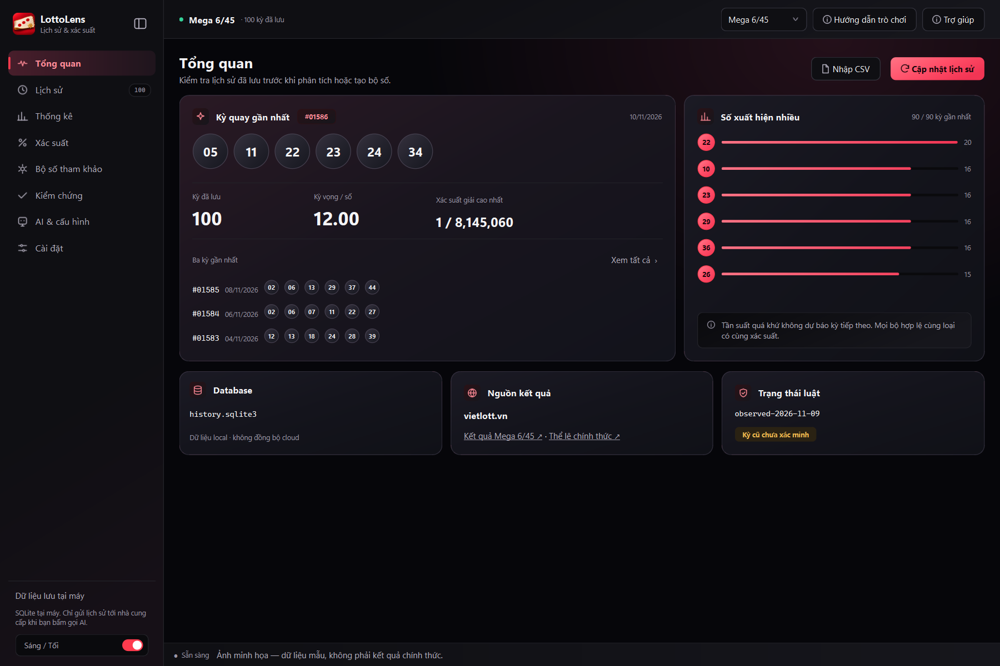
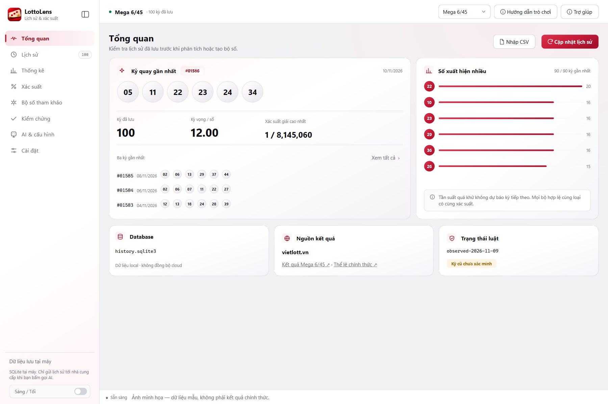
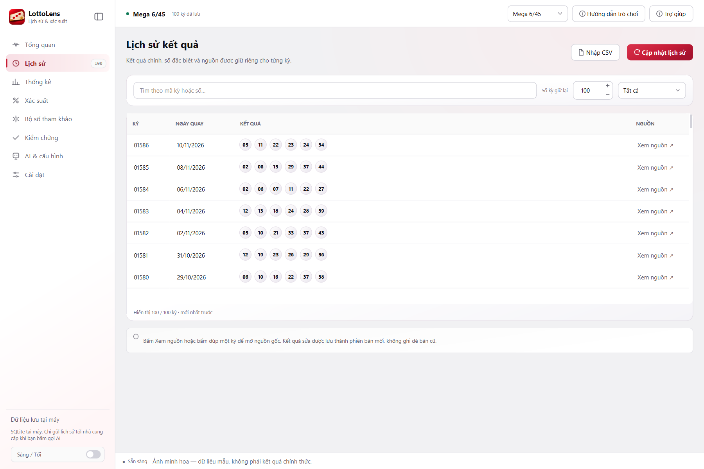
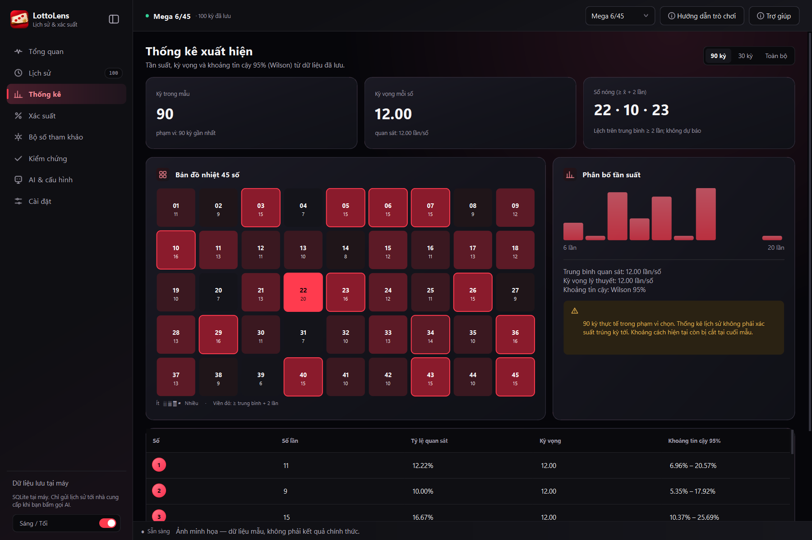
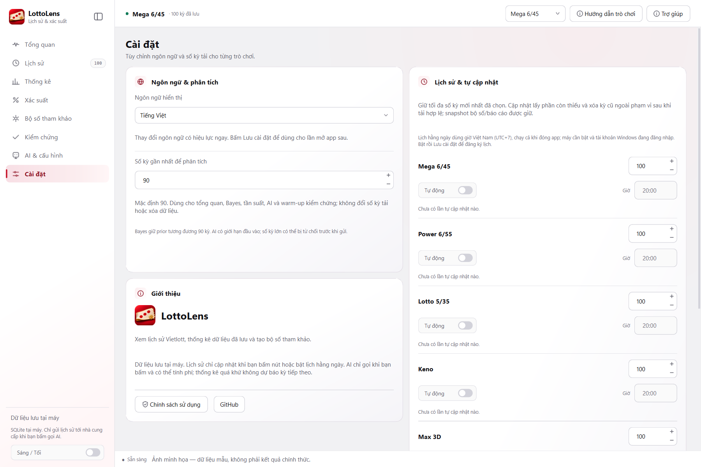
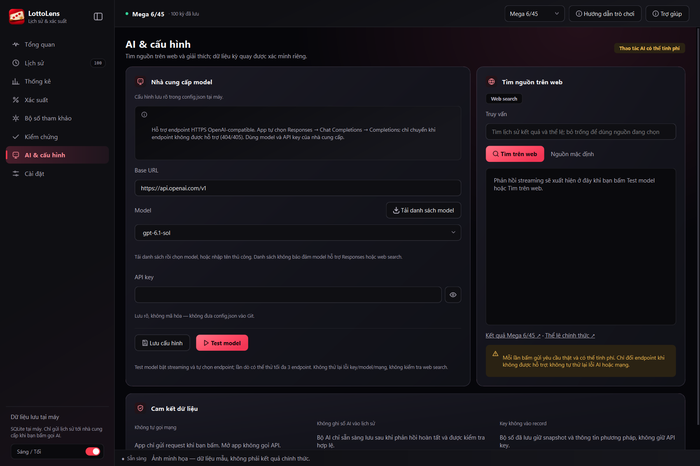

<p align="center"></p>
<h1 align="center">LottoLens</h1>
<p align="center">Lịch sử Vietlott, xác suất và thống kê — trong một ứng dụng desktop.</p>
<p align="center"><strong>Tiếng Việt</strong> · <a href="README.en.md">English</a></p>
<p align="center">
  
  
  
  <a href="LICENSE"></a>
</p>



**LottoLens** là ứng dụng Python/PySide6 giúp bạn tra cứu lịch sử Vietlott, khám phá dữ liệu đã lưu, xem xác suất lý thuyết và kiểm chứng phương pháp chọn số. Dữ liệu lưu tại máy bằng SQLite; AI là tính năng tùy chọn.

> LottoLens không cổ súy cá cược, cờ bạc hoặc mê tín dị đoan. Thống kê quá khứ, bộ số tham khảo và nội dung AI không bảo đảm dự đoán được kỳ tiếp theo hay tăng khả năng trúng. Đọc [chính sách sử dụng Việt–Anh](POLICY.md).

*Ảnh được chụp từ app thật với dữ liệu mẫu, không phải kết quả quay chính thức. Mở ảnh để xem kích thước đầy đủ.*

## Điểm nổi bật

- **Lịch sử có nguồn:** tải kết quả từ Vietlott, tìm theo kỳ/số và mở nguồn để đối chiếu. Đồng bộ tăng dần khi có mốc lịch sử đã xác minh.
- **Thống kê và xác suất:** tần suất, heatmap và xác suất theo mô hình luật; chọn số kỳ gần nhất dùng để phân tích.
- **Bộ số tham khảo:** đồng đều, tần suất, Bayes hoặc AI. Lưu bộ số cùng phương pháp và snapshot lịch sử đã dùng.
- **Kiểm chứng tại máy:** so phương pháp với lựa chọn ngẫu nhiên, chỉ dùng dữ liệu trước kỳ đang kiểm chứng.
- **Tự cập nhật từng trò:** chọn giờ theo Việt Nam, chạy qua Windows Task Scheduler ngay cả khi đóng app.
- **Giao diện Việt/Anh:** đổi ngôn ngữ trực tiếp, theme sáng/tối có gradient, sidebar thu gọn, hướng dẫn bằng ảnh và luật từng trò.
- **AI tùy chọn:** endpoint HTTPS OpenAI-compatible, tải danh sách model, nhập model thủ công và streaming.

<details>
<summary>Xem giao diện sáng</summary>



</details>

## Bắt đầu

### Chạy từ source

Đã kiểm tra với **Windows x64, Python 3.11 và PySide6 6.11.2**.

```powershell
git clone https://github.com/TKNguyenn/LottoLens.git
cd LottoLens
py -3.11 -m venv .venv
.\.venv\Scripts\python.exe -m pip install -r requirements.txt
.\.venv\Scripts\python.exe main.py
```

Lần mở đầu, cửa sổ chính hiện cùng popup chính sách. Tích riêng **Đã đọc** và **Chấp nhận** để tiếp tục tới hướng dẫn bằng ảnh. Mở lại hướng dẫn bằng **Trợ giúp** trên thanh trên; chính sách nằm trong **Cài đặt → Giới thiệu**.

### Bộ cài Windows

Xem [Releases](https://github.com/TKNguyenn/LottoLens/releases) để kiểm tra các bản phát hành. Nếu chưa có setup đính kèm, hãy chạy từ source hoặc [tự build bộ cài](packaging/README.md).

Bộ cài cho chọn thư mục lưu app và dữ liệu; máy đích không cần Python. Trang cuối có ô tạo shortcut Desktop và mở app. Khi gỡ, chọn **giữ dữ liệu** hoặc **xóa toàn bộ dữ liệu**; cả hai dọn lịch tự cập nhật của bản cài đó. Setup hiện chưa ký số, Windows có thể báo nhà phát hành không xác định.

## Hướng dẫn sử dụng

### 1. Chọn trò và tải lịch sử

Chọn trò ở thanh trên, rồi bấm **Cập nhật lịch sử**. Lần đầu app tải phạm vi đã đặt, mặc định 100 kỳ. Những lần sau app lấy phần mới tới vùng đã đồng bộ; khi tăng giới hạn hoặc cần xác minh dữ liệu, app có thể tải lại đủ phạm vi.

Sau lượt tải hợp lệ, app giữ tối đa số kỳ đã chọn và loại kỳ cũ ngoài phạm vi. Bộ số, báo cáo và snapshot đã lưu được giữ. Lỗi, hủy hoặc tải chưa hoàn tất không thay lịch sử đang có. **Nhập CSV** hỗ trợ các trò tập số theo [mẫu bên dưới](#csv-và-dòng-lệnh).



### 2. Xem thống kê và xác suất

Mở **Thống kê** để xem tần suất và heatmap. Mở **Xác suất** để xem mô hình lý thuyết theo trò, loại vé hoặc cách chơi. **Hướng dẫn trò chơi** giải thích cách chọn số, quay thưởng và điều kiện trúng từng hạng, kèm nguồn chính thức.

**Tần suất quan sát được không phải xác suất dự báo.** Với giả định quay công bằng, các bộ hợp lệ cùng loại vé có xác suất lý thuyết như nhau.



### 3. Tạo bộ tham khảo và kiểm chứng

Trong **Bộ số tham khảo**, chọn phương pháp và số bộ rồi tạo. Đồng đều dùng được khi chưa có lịch sử; tần suất, Bayes và AI cần đủ cửa sổ phân tích. Chỉ nhập **Kỳ dự định chơi** khi muốn lưu để đối chiếu sau này.

Trong **Kiểm chứng**, chọn phương pháp tại máy để so với lựa chọn ngẫu nhiên. Nếu đặt phân tích 100 kỳ nhưng chỉ lưu 100, kiểm chứng dùng tối đa 99 làm đầu vào, chừa kỳ để đối chiếu và hiện ghi chú. Cần ít nhất hai kỳ. AI không chạy backtest hàng loạt.

### 4. Cài đặt số kỳ và lịch tự cập nhật

| Cài đặt | Mặc định | Tác dụng |
| --- | --- | --- |
| Số kỳ giữ lại, riêng từng trò | 100 | Phạm vi lịch sử lưu sau cập nhật hợp lệ |
| Số kỳ gần nhất để phân tích | 90 | Đầu vào tổng quan, tần suất, Bayes, AI và warm-up kiểm chứng |

Trong **Cài đặt**, bật **Tự động**, chọn giờ từng trò rồi bấm **Lưu cài đặt**. Lịch theo **UTC+7**, chạy khi máy bật và tài khoản Windows đang đăng nhập, dù app đã đóng. Mặc định tất cả tắt. Không chạy bù khi lỡ giờ và không tự thử lại cùng trò trong ngày sau thất bại; dùng **Cập nhật lịch sử** để thử thủ công. Lịch Keno cập nhật chung kết quả cho cả 10 kiểu chọn số.



### 5. Dùng AI — tùy chọn

Tính năng tại máy không cần API key. Để dùng AI:

1. Mở **AI & cấu hình**, nhập Base URL HTTPS, mặc định `https://api.openai.com/v1`.
2. Nhập API key, bấm **Tải danh sách model** rồi chọn; có thể nhập model thủ công.
3. Bấm **Test model** để kiểm tra hoặc **Lưu cấu hình** để giữ cấu hình tại máy.
4. Chủ động dùng tìm nguồn web hoặc **AI phân tích lịch sử** khi cần.

App tự chọn Responses → Chat Completions → Completions, chỉ chuyển khi 404/405 xác định endpoint không hỗ trợ. Lỗi key/model/giới hạn/mạng, lỗi mơ hồ hoặc phản hồi đã bắt đầu sẽ dừng. Mỗi lần dò tối đa ba đường dẫn. Không tự gọi AI khi mở app. Web search và mức suy luận High cần provider/model hỗ trợ; Legacy Completions không hỗ trợ hai tính năng đó.

**AI có thể tính phí và đưa ra nội dung sai.** Phân tích lịch sử gửi dữ liệu cần thiết tới provider bạn chọn. Nếu bấm lưu, API key nằm rõ trong `config.json`; không đưa file này lên Git. Kết quả AI không được nhập làm kết quả quay chính thức.



## Các trò được hỗ trợ

| Trò | Xác suất và bộ tham khảo | Kiểm chứng theo hạng giải |
| --- | --- | --- |
| Mega 6/45 | Có | Có |
| Power 6/55 | Có, tách bonus | Có |
| Lotto 5/35 | Có, tách số đặc biệt | Có |
| Keno chọn 1–10 | Phân phối số trùng và bộ tham khảo | Chưa bật |
| Max 3D | Vé một bộ `000–999`, xác suất sự kiện | Chưa bật |
| Max 3D Pro | Hai bộ có thứ tự, cho phép cặp trùng | Chưa bật |
| Bingo18 | Đủ 38 lựa chọn trong các nhóm được mô hình hóa | Chưa bật |

Keno chưa có bảng xác suất tiền thưởng đầy đủ. Max/Bingo chưa mở mô phỏng, backtest hoặc tiền thưởng/EV đầy đủ. Chơi bao và Max 3D+ chưa có engine riêng. Luật là mô hình quan sát, không chứng nhận hiệu lực lịch sử cho mọi kỳ cũ. Xem [ma trận hỗ trợ](docs/game_support_matrix.md) và [nguồn kiểm chứng luật](docs/source_audit.md).

## Dữ liệu được lưu ở đâu?

| Cách chạy | Lịch sử và báo cáo | Cấu hình |
| --- | --- | --- |
| Bộ cài / EXE | `data/history.sqlite3` cạnh EXE | Cùng thư mục `data` |
| Python source | `%LOCALAPPDATA%/VietlottDesktop/history.sqlite3` | Gốc dự án |

`ui_preferences.json`, `theme.json`, `window_geometry.bin` tách khỏi cấu hình AI. EXE lưu xác nhận chính sách/hướng dẫn và cache nguồn trong `data`; source lưu chúng cạnh DB. Không đồng bộ cloud hoặc tự chuyển dữ liệu source sang bản cài. Đóng app trước khi sao lưu DB/cấu hình; với bản cài có thể sao lưu cả `data`.

## CSV và dòng lệnh

Mẫu CSV cho trò tập số:

```csv
draw_id,draw_date,main,special
01586,2026-11-08,01 02 14 20 23 36,
```

Ví dụ trong môi trường Python đã cài dependency:

```powershell
python main.py self-check
python main.py sync --game mega --limit 100
python main.py history --game mega
python main.py odds --game power
python main.py odds --game keno --mode pick8
python main.py import-csv --game mega "history.csv"
```

CLI có phạm vi riêng, chưa có đầy đủ lựa chọn vé Bingo18 và không thay mọi điều khiển GUI. Xem `python main.py --help`.

## Phát triển và kiểm tra

```powershell
python -m pip install pytest pytest-subtests
python -m pytest tests/ -q
python scripts/check_packaging.py
```

Test AI dùng phản hồi giả lập, không gọi provider thật. Bộ cài dùng PyInstaller và Inno Setup; xem [hướng dẫn build](packaging/README.md). Chụp lại ảnh README bằng `docs/images/capture.py`: chỉ dùng dữ liệu giả trong thư mục tạm và chặn mạng.

## License

**Copyright © 2026 TKNguyen.** **GNU GPLv3 only (`GPL-3.0-only`)** — [LICENSE](LICENSE), [COPYRIGHT](COPYRIGHT). Phân phối bản nhị phân hoặc bản sửa đổi phải tuân thủ GPLv3, bao gồm mã nguồn tương ứng. Thành phần bên thứ ba giữ license riêng. [POLICY.md](POLICY.md) mô tả mục đích/giới hạn app, không thêm hạn chế đối với quyền GPL.
